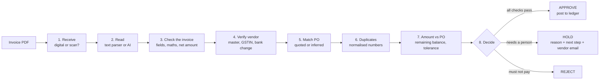

# Invoice Desk: from invoice PDF to payment decision

An automated accounts-payable process. Upload a vendor invoice and it reads the PDF, checks it against the vendor master, the purchase-order register and the payment ledger, then returns **Approve**, **Hold** or **Reject**, with the reason, the next step and, when the vendor needs to fix something, a draft reply. Every stage is visible as it runs, and every run is saved to a history dashboard.

Built for the Zamp AI Solutions Analyst case study, **PS-1 (Finance / AP)**.

| | |
|---|---|
| **Live app** | https://invoice-desk-9hxy.onrender.com |
| **Demo video** | https://youtu.be/tuJX-TK3ZlA?si=gRtmNKYoiYXqnbm_ |

> Hosted on Render's free tier: the first load after a quiet period can take about a minute.

---

## The problem

An AP clerk opens each vendor PDF, finds the matching PO in a spreadsheet, checks whether the numbers line up and decides what to do. Invoices arrive in every layout, some are scans, tax is sometimes included in prices, PO numbers are sometimes missing, and vendors split one PO across several invoices. It is slow, and the expensive mistakes (double payments, overbilling, fraud) are exactly the ones a tired person misses.

## Design principle: AI reads, rules decide

| Job | Tool | Why |
|---|---|---|
| Read a scan or an unfamiliar layout | Vision LLM (Groq, Gemini, Claude or any OpenAI-compatible model) | Unstructured input; templates break on every new vendor |
| Read a clean digital PDF | Rule-based text parser | Instant and free; the result is kept only if every required field is present and the numbers add up |
| Validate, match, detect duplicates, decide | Plain Python rules | Payment decisions must be repeatable and explainable to an auditor |

**Cheapest reliable reader first.** A digital PDF is read by the text parser. Anything else (a scan, a missing field, figures that don't reconcile) is escalated to the AI reader. If the AI provider is busy or down, the process retries, then falls back, and the run records why. It never approves an invoice it couldn't verify.

## How it works



1. **Receive document.** Detects whether the PDF has a text layer or is a scanned image.
2. **Read the invoice.** Extracts vendor, GSTIN, invoice number, date, PO reference, line items, tax lines and total.
3. **Check the invoice itself.** Required fields present, line items add up, subtotal plus tax equals total, date is sane. Normalises to a **net (pre-GST) amount**, because POs are raised before tax.
4. **Verify the vendor.** Matches the vendor master by GSTIN, then by name. A blocked vendor is rejected. A GSTIN mismatch or a request to pay new bank details is held.
5. **Match a purchase order.** Uses the PO quoted on the invoice. If none is printed, infers it from the vendor's open POs (70% amount fit, 30% description overlap) and accepts it only above 80% confidence with a clear winner.
6. **Look for duplicates.** Invoice numbers are normalised (`NCS/2026/0412` and `NCS-2026-412` both become `ncs-2026-412`), plus same-amount and close-date checks.
7. **Check amount against PO.** Compares with the **remaining** balance after earlier invoices, not the original PO value. Tolerance: 2% and at most ₹5,000. Totals above ₹10 lakh need a manager.
8. **Decide and record.** Any reject finding means Reject; any hold finding means Hold; otherwise Approve, and the invoice is posted to the ledger, which reduces the PO balance.

## Demo invoices and edge cases

Click **Reset demo data**, then run the cards top to bottom.

| # | Demo | What it tests | Result |
|---|---|---|---|
| 1 | Clean invoice, PO quoted | Happy path, CGST + SGST | **Approve** |
| 2 | Split billing over the PO | ₹6.2L already billed on a ₹10L PO; this ₹4.5L invoice overruns by ₹70,000 (18.4%) | **Hold** + vendor email |
| 3 | Re-sent invoice, new formatting | Already paid as `NCS/2026/0412`, resent as `NCS-2026-412` | **Reject** (duplicate) |
| 4 | No PO number, GST included | PO must be inferred; tax backed out of inclusive prices | **Approve** (PO-4505 inferred) |
| 5 | Scanned, invoice number blank | Image-only PDF, read by the AI; critical field missing | **Hold** |
| 6 | Seller not on the vendor list | Marketplace-style bill from an unregistered seller | **Hold** (route to onboarding) |
| 7 | Marketplace bill, no PO | Unfamiliar layout; PO inferred | **Approve** (PO-4509 inferred) |
| 8 | Slightly over the PO | ₹1,800 (1.5%) over | **Approve** (within tolerance, noted) |
| 9 | Asks to pay a new bank account | Bank-change request + GSTIN off by one character | **Hold** (likely fraud) |

Running card 1 a second time returns **Reject**: the first approval posted it to the ledger.

## The interface

- **Process invoice**: upload a PDF (or click a demo card) and watch the 8 stages run live; each stage expands to show what it found. The decision stamp shows the reason, next step and a copyable vendor email. Nothing is sent automatically.
- **Run history**: every run with decision, vendor, invoice number, total, PO and reason; counts, value approved, filters; click a row to reopen the full run.
- **PO register**: each PO's value, billed amount, remaining balance and the invoices posted against it.
- **Rules and assumptions**: the decision rules and assumptions in plain language.

## Run locally

Requires Python 3.10+.

```bash
# optional: conda create -n invoice-desk python=3.12 -y && conda activate invoice-desk
python -m pip install -r requirements.txt
cp .env.example .env            # Windows: copy .env.example .env  — then add your API key
python scripts/check_ai.py      # optional: confirms the AI reader works
python -m uvicorn app.main:app --reload
```

Open http://127.0.0.1:8000. Without any API key everything works except reading scans, which are routed to a person.

### AI reader configuration (`.env`)

Set **one** of these. Priority if several are set: Claude, then any OpenAI-compatible provider, then Gemini.

| Provider | Settings |
|---|---|
| Groq (free tier) | `LLM_BASE_URL=https://api.groq.com/openai/v1`, `LLM_API_KEY=gsk_...`, `LLM_MODEL=qwen/qwen3.8-27b` |
| Any OpenAI-compatible (OpenRouter, OpenAI, Mistral, Ollama) | `LLM_BASE_URL`, `LLM_API_KEY`, `LLM_MODEL` (must be a vision model) |
| Gemini | `GEMINI_API_KEY`, `GEMINI_MODEL=gemini-3.8-flash` |
| Claude | `ANTHROPIC_API_KEY` |

Other settings: `AI_MODE=auto` (default; AI only when needed) or `always`; `STAGE_MIN_SECONDS` (live-view pacing); `TODAY=YYYY-MM-DD` (freeze the date for repeatable demos).

## Deploy (Render)

1. Push the repo to GitHub.
2. In Render: **New → Blueprint**, select the repo (it reads `render.yaml`).
3. Enter `LLM_API_KEY` when asked; `LLM_BASE_URL` and `LLM_MODEL` come from `render.yaml`.
4. Deploy. Any Docker host works with the included `Dockerfile`.

The app needs a long-running server (live streaming of stages, SQLite run history), so serverless platforms are not a good fit.

## Project structure

```
app/
  main.py          web server: upload, live stage streaming (SSE), history, PO register, reset
  pipeline.py      the 8 stages and the decision logic
  extract.py       readers: text parser and AI providers, with retries and fallback
  db.py            SQLite run history and payment ledger
  static/index.html  the UI
data/
  vendors.csv, purchase_orders.csv, ledger_seed.csv   master data standing in for the ERP
  rules.json       tolerances and limits, editable without code changes
  samples/         the 9 demo invoices
scripts/
  make_samples.py, make_test_bills.py   regenerate the demo invoices
  check_ai.py      test the configured AI reader
```

## Assumptions

- The buyer is an Indian company: invoices in INR with GST (CGST + SGST within a state, IGST across states).
- POs are raised net of GST, so invoices are compared on their pre-tax amount.
- Dates such as `03-11-2026` are day-month-year.
- Two-way match (invoice to PO); goods-receipt matching is out of scope.
- Vendor master, POs and the opening ledger are CSV files standing in for the ERP.
- A missing invoice number blocks auto-approval, because duplicate detection can't be trusted without it.
- Nothing is paid or sent automatically; vendor replies are drafts for a person.

## What I'd build next

- Three-way match against goods receipts.
- Pull invoices straight from the AP inbox.
- A reviewer queue with approve and override actions, and threshold tuning from those overrides.
- An ERP connector in place of the CSV files.
